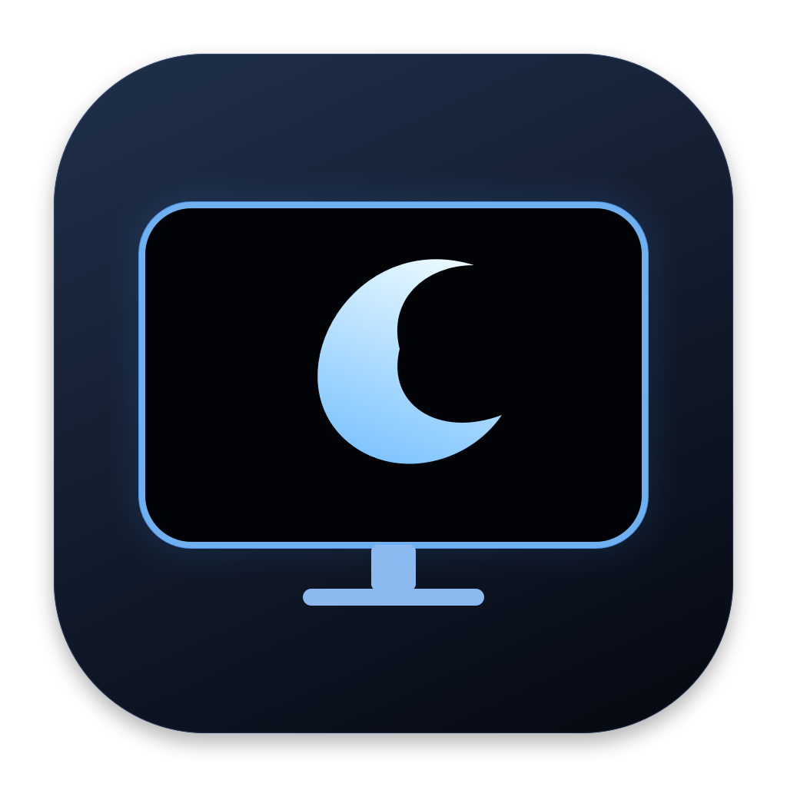
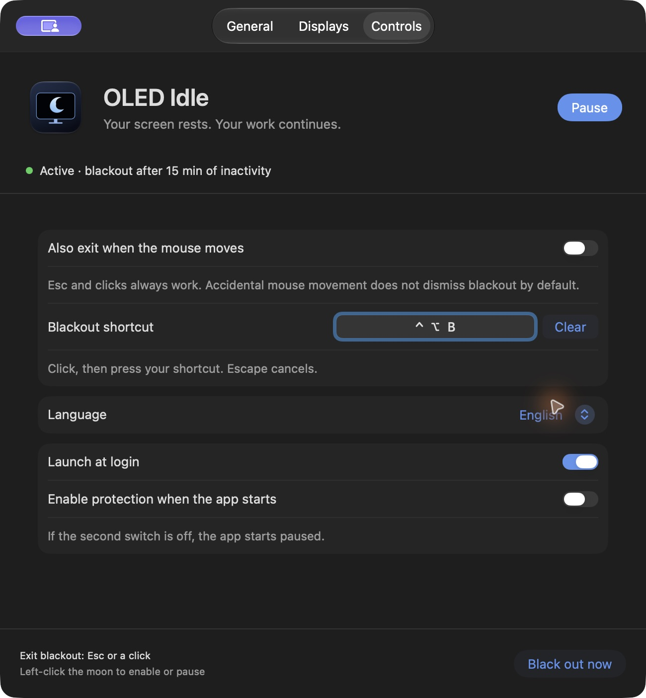

# OLED Idle

[English](README.md) · [Русский](README.ru.md)



**Your screen rests. Your work continues.**

A native macOS menu-bar app that covers OLED displays with pure black after inactivity while keeping your Mac awake. Built with Swift, AppKit and SwiftUI, without third-party runtime dependencies.

[Download the latest release](https://github.com/imvitalya/oled-idle/releases/latest)



## Features

- Automatic blackout after **1–180 minutes** without keyboard or mouse input; **15 minutes** by default.
- Built-in keep-awake behavior. Standalone mode works without Caffeine or OLED Blackout.
- All displays or a selected set, identified by their display UUIDs. Identical monitor models can be selected separately.
- Manual blackout from the menu, Settings, or **your own keyboard shortcut**.
- Click the shortcut field and press a combination. Escape cancels recording; Clear disables the shortcut. Use Command, Control or Option with a key, or an unmodified F key. Conflicts are reported.
- Exit with **Esc or a mouse click**; optionally exit on mouse movement. Every exit starts a fresh idle interval.
- **English and Russian**, with a system-language option and immediate switching.
- Optional login launch and an option to start enabled. Both are off by default.
- Optional Caffeine mode: automatic blackout only while Caffeine is active.
- No accounts, telemetry or network requests in the app.

## Install

1. Download `OLED-Idle-2.1.0-universal.zip` from [Releases](https://github.com/imvitalya/oled-idle/releases).
2. Unzip it and move **OLED Idle.app** into **Applications**.
3. Open the app and click the moon in the menu bar to enable it.

Requires **macOS 13 or later**. The universal app includes **Apple Silicon and Intel** binaries. Runtime checks were performed on Apple Silicon; Intel was cross-compiled, not tested on an Intel Mac.

**Signing:** this release is ad hoc signed and is **not notarized by Apple**. macOS may block a downloaded copy. If you trust this source, attempt to open it, then use **System Settings → Privacy & Security → Open Anyway**. Building from source is also supported. `SHA256SUMS` is provided with each release.

## Everyday use

| Action | Result |
| --- | --- |
| Left-click the moon | Enable / pause |
| Filled moon | Automatic protection enabled |
| Outline moon | Automatic protection paused |
| Right-click the moon | Open menu, Settings, manual blackout, log or Quit |
| Open the app again | Show Settings |
| Esc or click during blackout | Restore the desktop |

The app starts paused unless **Enable protection when the app starts** is selected. The initial shortcut is **Control + Option + Command + B**; you can record a more comfortable one. Existing shortcuts are preserved when upgrading from version 2.0.

Recording uses events in the focused settings window and temporarily unregisters the global shortcut. It does not need Accessibility or Input Monitoring permission. Keyboard layout/Fn behavior and system-reserved shortcuts still follow macOS.

In standalone mode, enabling the app prevents idle system/display sleep. Pause or Quit releases those requests. Manual blackout works while automatic protection is paused and holds the requests only until it is dismissed. The first half-second ignores pointer movement/clicks to avoid immediately dismissing a new blackout; Esc is always available.

### With Caffeine

Choose **With Caffeine** in General. Automatic blackout then follows the cup's actual active state. macOS may ask for Automation permission to read Caffeine; standalone mode does not need it. If access is denied, grant permission in macOS and click **Retry check**. Caffeine is controlled independently.

### What blacking out means

The app draws opaque RGB-black windows. On OLED panels, black pixels stop emitting light. This **does not power down the monitor**, enter hardware standby or initiate pixel-cleaning cycles. It is **not a privacy lock**. Manual locking, explicit sleep and enforced macOS security policies remain in effect. Switching to another app dismisses blackout so keyboard input cannot go invisibly to an app behind the overlay.

## Build

Install Apple's Command Line Tools (`xcode-select --install`) and Python 3. Then, from the repository root:

```bash
python3 oled-idle-app/build.py --universal --archive
```

The script runs native tests, compiles both architectures, generates the original icon, copies both localizations, signs the app ad hoc and creates a ZIP plus checksums under `oled-idle-app/dist/`. Omit `--universal` to build only for the current Mac. No package downloads are required by the build.

To install locally, quit the running app and run:

```bash
python3 oled-idle-app/build.py --install
open '/Applications/OLED Idle.app'
```

The installer refuses unrelated bundles and running copies. Previous versions are backed up in `~/Library/Application Support/OLED Idle/Backups`.

## Checks and diagnostics

```bash
python3 tests/run-native-tests.py
python3 tests/run-system-tests.py
# Optional: briefly black out the screens, then restore them automatically.
python3 tests/run-system-tests.py --blackout
```

Tests cover preference migration, custom-shortcut validation, both languages, idle-policy decisions, stale asynchronous results, manual rearming, display selection and settings updates. System checks briefly acquire/release real power assertions and a shortcut; the visible test also checks overlays and dismissal events. Run system checks in an unlocked graphical macOS session.

The log is at `~/Library/Logs/OLED Idle.log` and is bounded to roughly 1 MiB. Diagnostic arguments: `--settings`, `--enabled`, and `--dry-run`. Dry run skips blackout while still exercising the real keep-awake behavior.

## Project status

This is the first public release. Automatic updates and CI are not configured. The app icon is original vector artwork generated by `BuildIcon.swift`; SF Symbols are used only in the interface and menu bar. A software license has not yet been selected by the repository owner.
