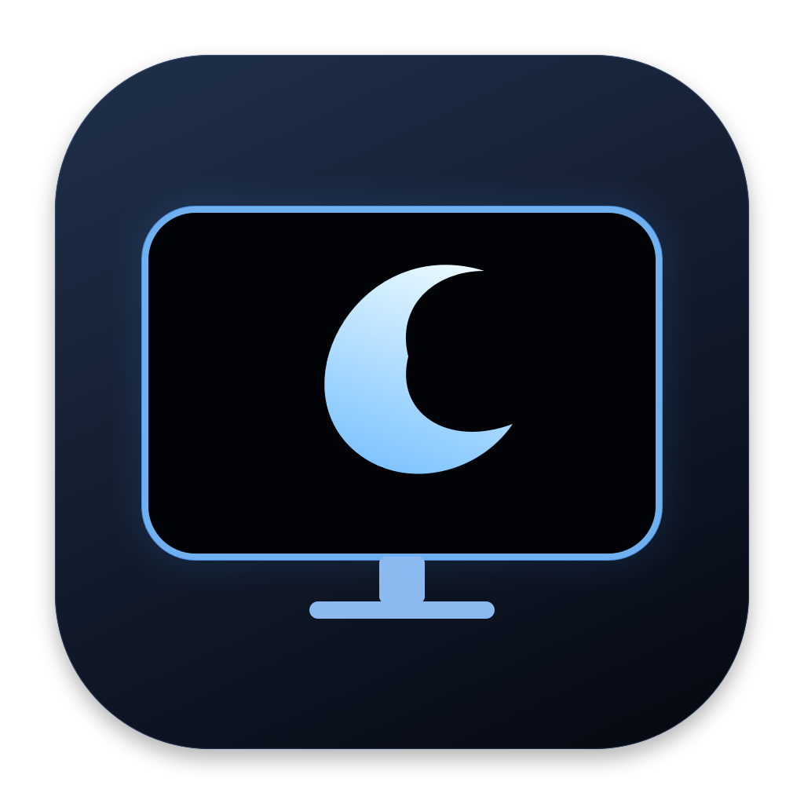
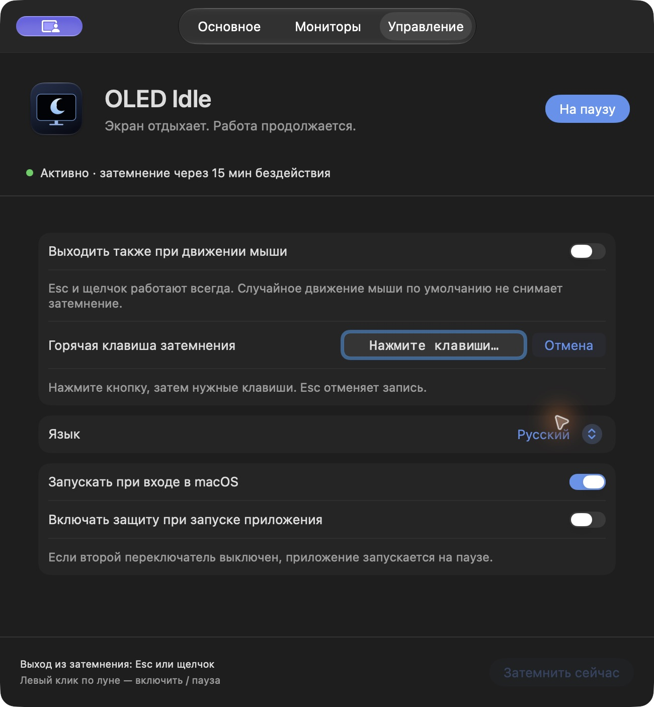

# OLED Idle

[English](README.md) · [Русский](README.ru.md)



**Экран отдыхает. Работа продолжается.**

Нативное приложение для macOS: после бездействия закрывает OLED-мониторы чистым черным цветом и удерживает Mac активным. Написано на Swift, AppKit и SwiftUI, без сторонних зависимостей во время работы.

[Скачать последнюю версию](https://github.com/imvitalya/oled-idle/releases/latest)



## Возможности

- Автозатемнение после **1–180 минут** без мыши и клавиатуры; по умолчанию — **15 минут**.
- Собственное удержание Mac активным. В самостоятельном режиме Caffeine и OLED Blackout не нужны.
- Все мониторы или выбранные экраны. Выбор сохраняется по системным идентификаторам, поэтому одинаковые модели различаются.
- Ручное затемнение из меню, настроек или по **своей комбинации клавиш**.
- Нажмите поле сочетания и нужные клавиши. Esc отменяет запись, «Очистить» отключает сочетание. Поддерживаются Command, Control или Option с клавишей, а также F-клавиши без модификаторов. О конфликте приложение сообщит.
- Выход по **Esc или щелчку**, дополнительно — при движении мыши. После выхода начинается новый отсчет бездействия.
- **Русский и английский языки**, системный выбор и переключение без перезапуска.
- Автозапуск при входе и включение защиты при старте. По умолчанию оба параметра выключены.
- Дополнительный режим Caffeine: автозатемнение работает только при активной чашке.
- В приложении нет учетных записей, телеметрии и сетевых запросов.

## Установка

1. Скачайте `OLED-Idle-2.1.0-universal.zip` в разделе [Releases](https://github.com/imvitalya/oled-idle/releases).
2. Распакуйте архив и перенесите **OLED Idle.app** в **Программы**.
3. Откройте приложение и нажмите на луну в строке меню, чтобы включить защиту.

Нужна **macOS 13 или новее**. Универсальная сборка содержит версии для **Apple Silicon и Intel**. Работу проверяли на Apple Silicon; версия для Intel скомпилирована, но на Intel Mac не запускалась.

**Подпись:** релиз подписан локальной подписью ad hoc и **не нотариализован Apple**. macOS может заблокировать скачанную копию. Если вы доверяете исходникам, попробуйте открыть приложение, затем используйте **Системные настройки → Конфиденциальность и безопасность → Все равно открыть**. Также можно собрать приложение самостоятельно. В релизе есть файл контрольных сумм `SHA256SUMS`.

## Использование

| Действие | Результат |
| --- | --- |
| Левый клик по луне | Включить / поставить на паузу |
| Заполненная луна | Автозатемнение включено |
| Контурная луна | Автозатемнение на паузе |
| Правый клик по луне | Меню, настройки, ручное затемнение, журнал и выход |
| Повторное открытие приложения | Открыть настройки |
| Esc или щелчок при затемнении | Вернуть изображение |

Приложение стартует на паузе, если не включен параметр «Включать защиту при запуске приложения». Начальное сочетание — **Control + Option + Command + B**, его можно заменить удобным. При обновлении с версии 2.0 существующая комбинация сохраняется.

Запись использует события только активного окна настроек и временно отключает глобальную комбинацию. Разрешения «Универсальный доступ» и «Мониторинг ввода» не нужны. Работа раскладки, Fn и системных сочетаний зависит от macOS и клавиатуры.

В самостоятельном режиме включенное приложение запрещает сон системы и дисплеев из-за бездействия. Пауза и выход снимают эти запреты. Ручное затемнение работает и на паузе, удерживая Mac активным до выхода из черного экрана. Первые полсекунды движения и щелчки игнорируются, чтобы действие запуска не закрыло затемнение сразу; Esc доступен всегда.

### Режим Caffeine

Выберите «При включенном Caffeine» в основных настройках. Автозатемнение будет учитывать фактическое состояние чашки. macOS может запросить разрешение автоматизации для чтения Caffeine; самостоятельному режиму оно не требуется. Если доступ запрещен, разрешите его в macOS и нажмите «Повторить проверку». Самим Caffeine вы управляете отдельно.

### Что означает затемнение

Приложение рисует непрозрачные окна с RGB-черным цветом. Черные пиксели OLED перестают светиться. Это **не выключает питание монитора**, не включает аппаратный standby и не запускает очистку пикселей. Затемнение **не является блокировкой доступа**. Ручная блокировка, явный сон и обязательные политики безопасности macOS продолжают действовать. При переключении в другое приложение затемнение снимается, чтобы ввод не уходил невидимому окну за ним.

## Сборка

Установите Apple Command Line Tools (`xcode-select --install`) и Python 3. В корне репозитория выполните:

```bash
python3 oled-idle-app/build.py --universal --archive
```

Скрипт запускает тесты, компилирует обе архитектуры, рисует оригинальную иконку, добавляет переводы, подписывает приложение ad hoc и создает ZIP с контрольными суммами в `oled-idle-app/dist/`. Без `--universal` сборка выполняется только для архитектуры текущего Mac. Загрузка сторонних пакетов не требуется.

Для локальной установки закройте работающее приложение и выполните:

```bash
python3 oled-idle-app/build.py --install
open '/Applications/OLED Idle.app'
```

Установщик не перезаписывает посторонние приложения и работающие копии. Предыдущая версия сохраняется в `~/Library/Application Support/OLED Idle/Backups`.

## Проверки и диагностика

```bash
python3 tests/run-native-tests.py
python3 tests/run-system-tests.py
# Необязательно: ненадолго затемнить экраны и автоматически вернуть изображение.
python3 tests/run-system-tests.py --blackout
```

Тесты проверяют перенос настроек, свои сочетания, оба языка, таймер, устаревшие асинхронные ответы, повторный отсчет, выбор мониторов и изменение настроек. Системные проверки ненадолго создают и снимают настоящие запреты сна и горячую клавишу; видимый тест также проверяет черные окна и события выхода. Запускайте их в разблокированном графическом сеансе macOS.

Журнал: `~/Library/Logs/OLED Idle.log`, размер ограничен примерно 1 МиБ. Диагностические аргументы: `--settings`, `--enabled`, `--dry-run`. Последний пропускает затемнение, но сохраняет реальное удержание Mac активным для проверки.

## Состояние проекта

Это первый публичный релиз. Автообновления и CI пока не настроены. Иконка — оригинальный векторный рисунок из `BuildIcon.swift`; SF Symbols используются только в интерфейсе и строке меню. Лицензию на исходный код владелец репозитория пока не выбрал.
